# n8n-nodes-argorant

n8n nodes for [Argorant](https://argorant.com), the whole outbound workflow in one place: find leads, check every email, build lists, write and launch campaigns, and handle the replies, in a workflow or from an n8n AI agent.

Two nodes:

* **Argorant**: 54 operations across leads, companies, emails, lists, exports, campaigns, replies, mailboxes, the blocklist and your account. Usable as a tool by the n8n AI Agent.
* **Argorant Trigger**: starts a workflow on a new reply, a reply marked interested, a bounce, an unsubscribe, a paused campaign, a ready export or list, and more.

[n8n](https://n8n.io/) is a [fair-code licensed](https://docs.n8n.io/sustainable-use-license/) workflow automation platform.

[Quick start](#quick-start) · [Operations](#operations) · [What costs credits](#what-costs-credits) · [Argorant Trigger](#argorant-trigger) · [AI agents](#ai-agents) · [Credentials](#credentials) · [Templates](#templates) · [Limits and errors](#limits-and-errors) · [Version history](#version-history)

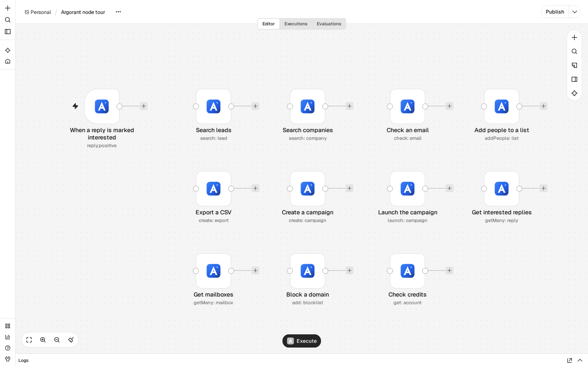

## Quick start

1. In n8n, open **Settings > Community Nodes**, select **Install**, enter `n8n-nodes-argorant` and install. On n8n Cloud the node shows up in the nodes panel once n8n has verified it.
2. In Argorant, open **Settings > API keys** ([app.argorant.com/settings?section=api-keys](https://app.argorant.com/settings?section=api-keys)) and create a key. It starts with `ag_live_`.
3. Add the **Argorant** node, create an **Argorant API** credential with the key. n8n tests it right away.
4. Try **Lead > Count** with a job title and a country. It is free and tells you how big the market is.

A first workflow that runs end to end:

1. **Lead > Count**: size the market, for example Head of Operations in Texas at companies with 51 to 500 people.
2. **List > Create**: save that search as a list. Free.
3. **Campaign > Create**: name, emails (write them yourself or with your own AI model in an earlier node), sending window and mailboxes. Free; nothing sends.
4. **Campaign > Add Leads**: add the list. Only people with a valid email join. 1 credit per new person.
5. **Campaign > Launch** with **Confirm Launch** on, after you checked the campaign. With Confirm Launch off the node only reports whether the campaign is ready.
6. **Argorant Trigger** on **Reply Marked Interested**, then a Slack, email or CRM node of your choice.

## Operations

Every operation states its cost in the node. Lists, campaigns, mailboxes and saved searches are picked from a searchable list, by URL or by ID, so nobody has to type IDs. Every list and search has **Return All** or **Limit** and a **Simplify** switch (on: clean flat fields; off: the full answer).

| Resource | Operation | What it does | Cost |
|---|---|---|---|
| Account | Get | Plan, credits available, campaign emails left this month, daily limits, key scopes | Free |
| Lead | Count | How many people match filters (title, seniority, department, industry, size, revenue, place, radius and more) | Free |
| Lead | Search | Masked preview of matching people with a record ID each; filters from the node or from a saved search | Free |
| Lead | Reveal | Full contact details with a checked work email, by record ID (batched 25 at a time) or the next people for filters | 1 credit per contact whose email passes the check |
| Lead | Enrich | The person behind an email, or a person by name at a company domain | 1 credit per person found whose email passes the check |
| Lead | Get Phone Numbers | Direct or mobile numbers by record ID (batched 100 at a time) | 10 credits per number returned |
| Company | Count | How many companies match filters | Free |
| Company | Search | Companies with name, domain, industry, size and place | Free |
| Company | Get | One company by domain: profile, people count, how many have a work email, masked preview | Free |
| Email | Find | A work email from a name and a company domain | 1 credit when found, 0.25 when nothing is found |
| Email | Check | Whether an address can receive mail: valid, invalid, catch_all, risky or unknown | Half a credit per fresh check |
| List | Create | Save a search or the people you picked as a list | Free |
| List | Get | A list with its size and fill progress | Free |
| List | Get Many | Your lists and saved searches | Free |
| List | Get People | The people in a list, masked unless already revealed | Free |
| List | Add People | By record ID (batched), by filters or from a saved search; people already in it are skipped | Free |
| List | Remove People | By record ID or by filters, with a preview | Free |
| List | Rename | New name for a list | Free |
| List | Delete | Delete a list; exports and campaigns keep their people | Free |
| List | Export | CSV of the list; every email is checked when the file is built | 1 credit per contact whose email passes the check |
| Export | Create | CSV of the people who match filters or a saved search, optionally waiting for the file | 1 credit per contact whose email passes, plus 10 per phone number if asked |
| Export | Get | Status, rows and credits of an export | Free |
| Export | Get Many | Your exports | Free |
| Export | Download | The CSV as a file in n8n | Free |
| Campaign | Create | A draft with name, emails, schedule, limits and mailboxes | Free |
| Campaign | Get | A campaign with emails, mailboxes and launch blockers | Free |
| Campaign | Get Many | Your campaigns with status and counts, by tag or status | Free |
| Campaign | Update | Name, schedule, limits and other settings | Free |
| Campaign | Write Emails | Replace the sequence with your subjects, bodies and waiting days | Free |
| Campaign | Set Mailboxes | Attach connected mailboxes, or all of them | Free |
| Campaign | Add Leads | From input items (one person per item, batched, extra columns become variables), a saved list or record IDs; only valid emails join | 1 credit per new person from Argorant data; your own rows are free |
| Campaign | Get Leads | People in a campaign with their status | Free |
| Campaign | Remove Leads | By email (batched), status, tag or saved list, with a preview | Free |
| Campaign | Set Up Personal Lines | Variables such as {{custom_opener}} with a fallback | Free |
| Campaign | Write Personal Lines | One line per person, for example written by your own AI model (batched) | Free |
| Campaign | Launch | Start sending; needs Confirm Launch, otherwise a readiness check only | No credits; sends email, counts against your monthly campaign emails |
| Campaign | Pause | Hold sending | Free |
| Campaign | Resume | Continue a paused campaign; needs Confirm Launch | No credits; sends email |
| Campaign | Stop | End a campaign for good | Free |
| Campaign | Get Stats | Totals and a daily series of sends, replies, positive replies, bounces and unsubscribes | Free |
| Campaign | Send Test Email | One test email to you or a member of your workspace | Free; sends one email to you |
| Campaign | Duplicate | Copy as a new draft without people or results | Free |
| Campaign | Delete | Delete a draft, paused or stopped campaign | Free |
| Reply | Get Many | Replies, bounces and unsubscribes across campaigns, by folder, campaign, status or text | Free |
| Reply | Get | One conversation with the whole thread | Free |
| Reply | Get Statuses | The statuses a conversation can have, including your own stages | Free |
| Reply | Set Status | Mark a conversation, for example Interested or Meeting booked | Free |
| Reply | Send Reply | Answer in the same thread from the mailbox that received it | Free; sends email at once |
| Reply | Forward | Forward a conversation to up to 10 addresses | Free; sends email at once |
| Mailbox | Get Many | Sending mailboxes with status, sends today, warm-up and what needs fixing | Free |
| Mailbox | Update | Daily limit, warm-up, sending on or off, display name | Free |
| Blocklist | Add | Never email an address or a whole domain again | Free |
| Blocklist | Get Many | Blocked addresses and domains | Free |
| Blocklist | Remove | Unblock an entry | Free |

### Screenshots

| | |
|---|---|
| 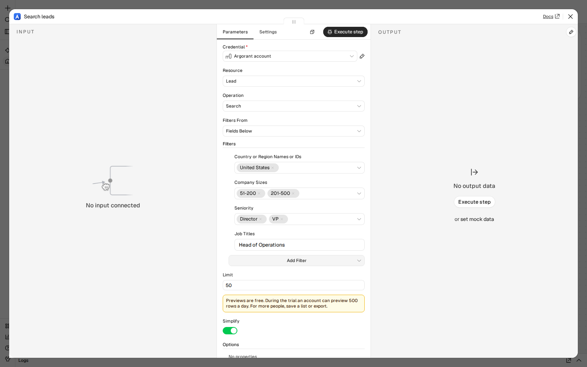 | 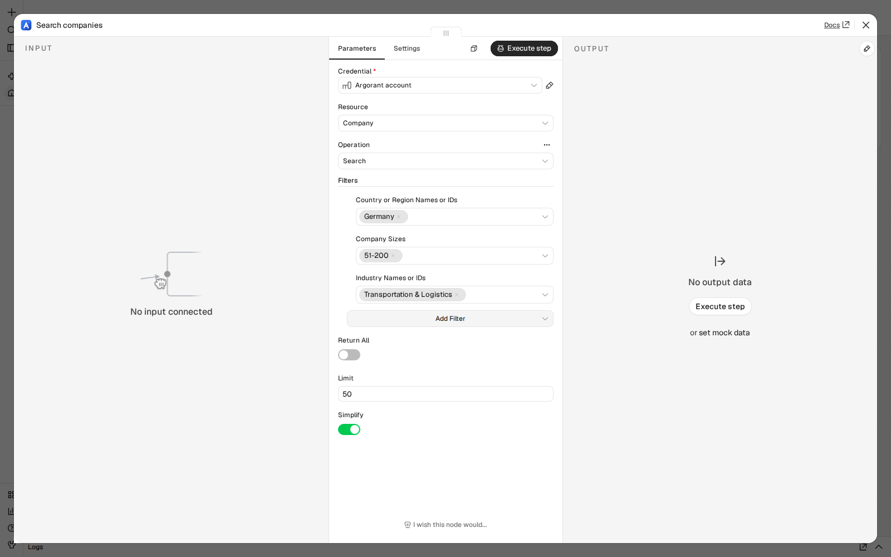 |
| 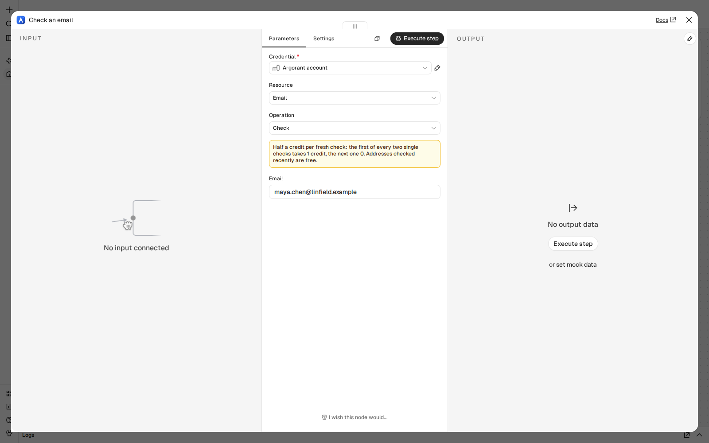 | 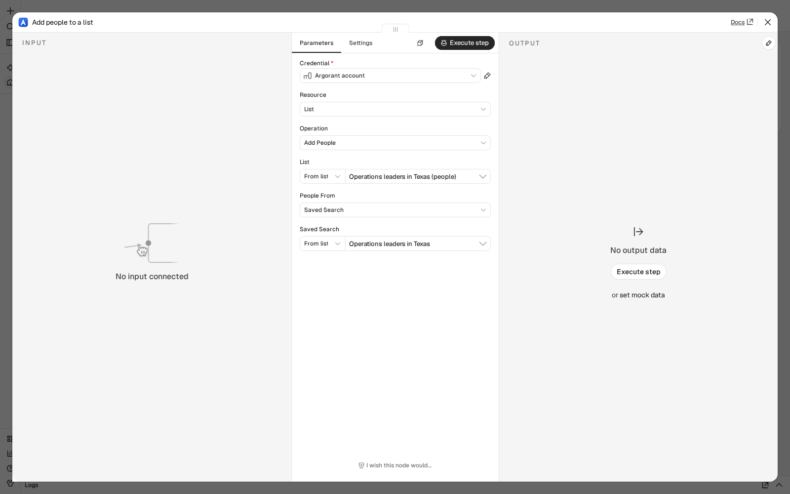 |
| 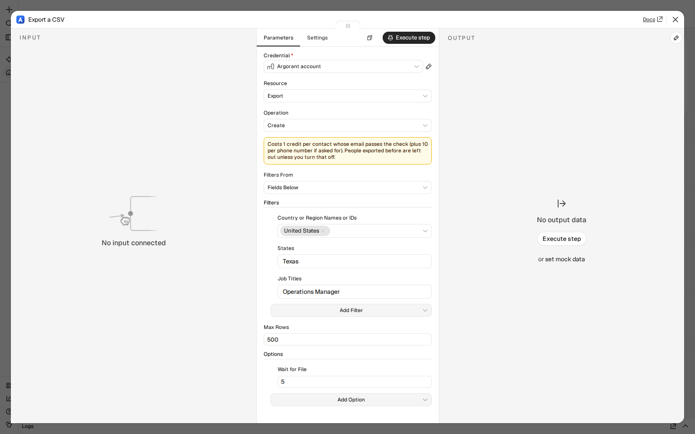 | 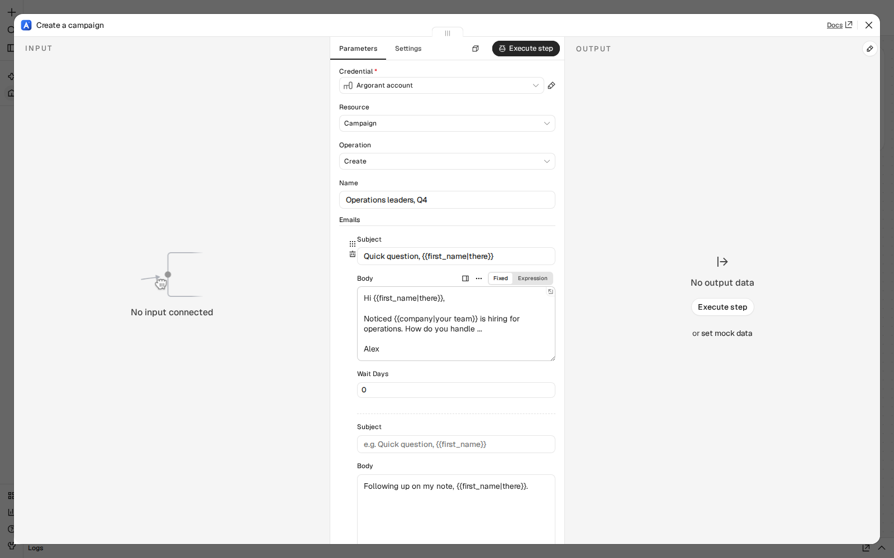 |
| 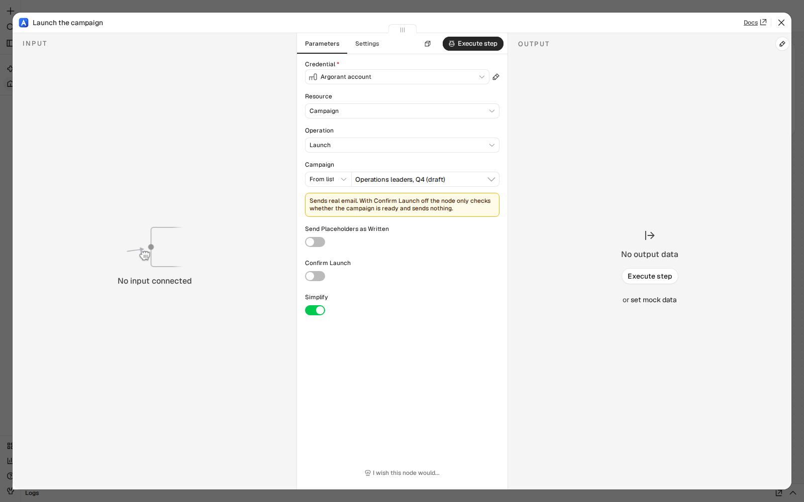 | 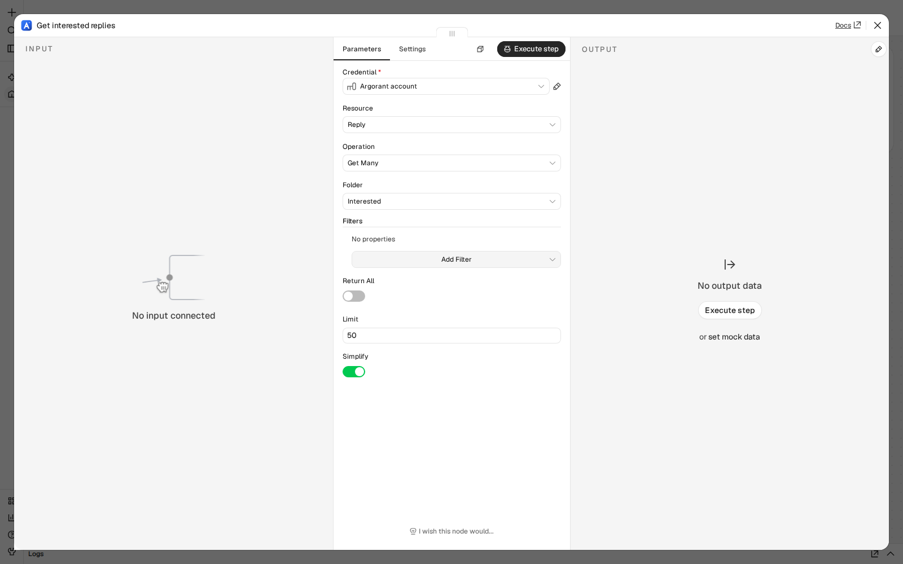 |
| 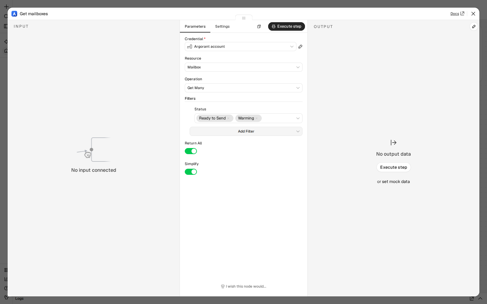 | 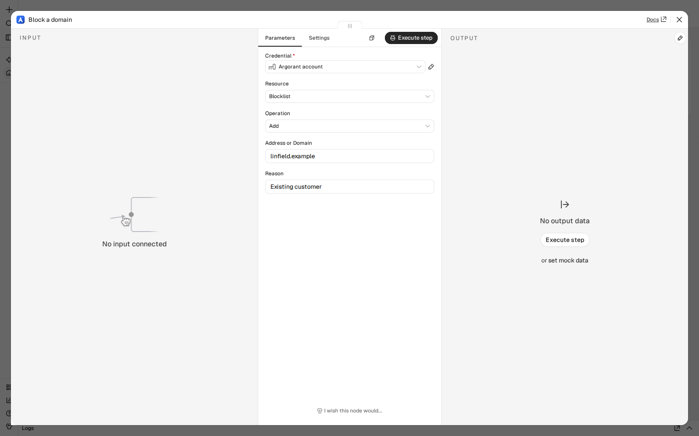 |
| 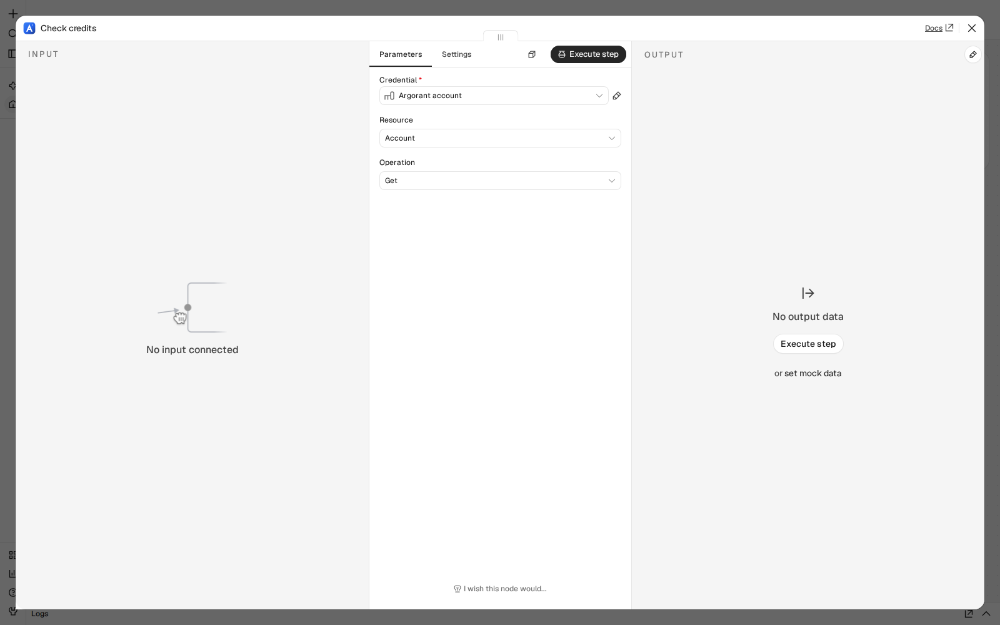 | 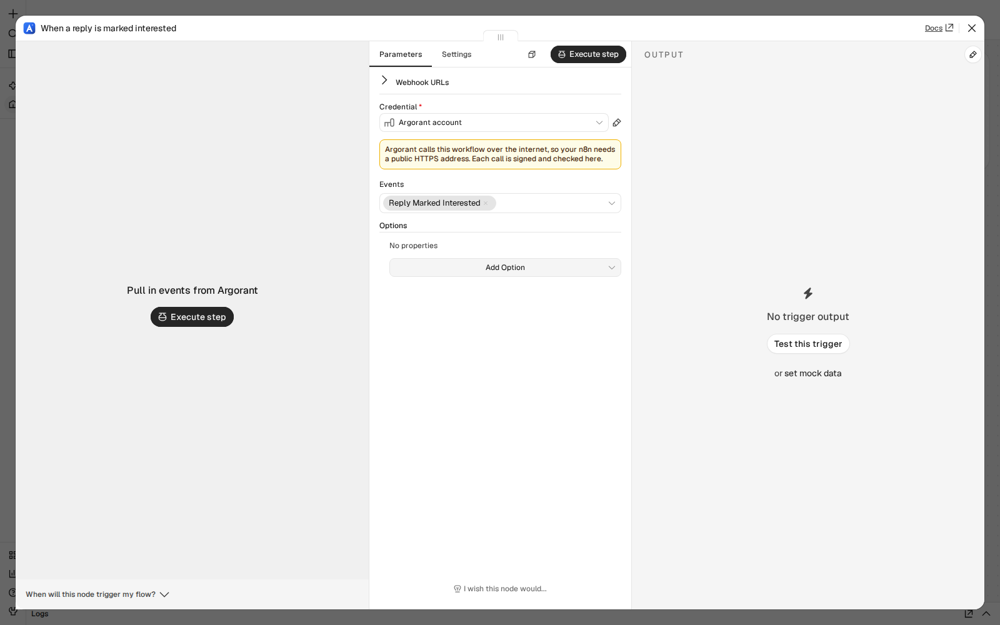 |

## What costs credits

Only these operations use credits, and each one says so in the node:

* **Lead > Reveal**: 1 credit per contact whose email passes the check. Contacts that fail cost nothing; people you revealed before are free.
* **Lead > Enrich**: 1 credit per person found whose email passes the check. Misses and repeats are free.
* **Lead > Get Phone Numbers**: 10 credits per number returned. No number, no charge. Pro plan and higher.
* **Email > Find**: 1 credit when an address is found, 0.25 when nothing is found.
* **Email > Check**: half a credit per fresh check (the first of every two single checks takes 1 credit, the next one 0). Addresses checked recently are free.
* **List > Export** and **Export > Create**: 1 credit per contact whose email passes the check, plus 10 per phone number when asked for. People exported before are left out by default.
* **Campaign > Add Leads**: 1 credit per new person from Argorant data. Your own rows, repeats and people you already revealed are free.

Everything else is free. Campaign emails never use credits; Launch, Resume, Send Test Email, Send Reply and Forward send email and are marked so.

No operation runs an Argorant AI model. Write campaign copy and personal lines with your own AI model (any chat model node in n8n), then save it with **Campaign > Write Emails** or **Write Personal Lines**.

## Argorant Trigger

Starts a workflow when Argorant calls it. When you activate the workflow, the node registers a webhook in your Argorant account; when you deactivate it, the webhook is removed. Every call is signed (`X-Argorant-Signature`, HMAC-SHA256 of the body) and the node refuses calls with a wrong signature.

| Event | When |
|---|---|
| New Reply | A person replied to a campaign. Out of office and other automatic replies are left out. |
| Reply Marked Interested | A reply was labeled Interested or Meeting request, by Argorant or by your team |
| Lead Bounced | An email of a campaign bounced |
| Lead Unsubscribed | A person asked to stop, by reply or by the unsubscribe link |
| Campaign Paused | A campaign paused by itself: high bounces, mailboxes offline, or the monthly campaign emails used up |
| Campaign Resumed | A campaign paused for its monthly campaign emails sends again |
| Export Ready | An export finished |
| List Ready | A saved list finished filling |
| Email Checked | A single email check finished |
| New Matches for a Saved Search | A saved search now finds more people than before |

Options: only events of chosen campaigns, and ignoring test events. Argorant calls public HTTPS addresses only, so your n8n needs a public `https://` URL (the `WEBHOOK_URL` setting when self-hosted). An account holds up to 10 webhooks.

## AI agents

The Argorant node is usable as a tool: connect it to the **Tool** input of an **AI Agent** node, choose the resource and operation, and let the model fill fields (the sparkle button next to a field). Each operation has a precise description, including its cost, so the agent picks the right one.

Good patterns:

* Give the agent the free tools (Count, Search, Create List, Create Campaign, Write Emails, Get Stats) freely, and the paid ones (Reveal, Find, Add Leads) with a clear instruction in the system message.
* Add **Launch** twice: once with Confirm Launch off as "check if ready", and once with Confirm Launch filled by the model only after the user says yes in chat. The template "One sentence to campaign with your AI agent" shows this.
* **Account > Get** tells the agent how many credits are left before it spends any.

## Credentials

1. Sign up at [argorant.com](https://argorant.com).
2. In Argorant, open **Settings > API keys** and create a key (it starts with `ag_live_`). Keys can be limited to scopes; the node tells you which scope a call needs when the key lacks it.
3. In n8n, create an **Argorant API** credential and paste the key.

The key acts as your Argorant account, with its plan, credits and limits.

## Templates

Ready workflows are in [templates](templates/README.md): from one sentence to a campaign with your own AI agent, CRM and spreadsheet syncs, reply alerts and triage, bounce and unsubscribe hygiene, weekly reports and more. Import one with **Import from file** in n8n.

## Limits and errors

* **Retries.** When Argorant answers busy (too many requests a minute, or a short outage), the node waits and tries again up to 5 times. Writes carry one idempotency key across tries, so a retry never does the work twice. A daily limit is not retried.
* **Batches.** Operations that take many people (Add Leads, Add People, Remove People, Reveal, Get Phone Numbers, Write Personal Lines, Remove Leads by email) combine all input items and send them in batches.
* **Clear errors.** Not enough credits says how many are needed, how many you have and where to add more. A missing key scope names the scope. A blocked launch lists what is missing, such as a sending mailbox or people with a valid email. Turn on **Continue On Fail** in the node settings to get the error as an item instead of stopping the workflow.
* **Plan limits.** During the trial an account can count 500 times and preview 500 rows a day, and each key can reveal 100 people a day. Plans have no daily limit on searches and counts. Requests per minute depend on the plan; **Account > Get** shows yours.

## Compatibility

Built with the n8n community node CLI (`@n8n/node-cli` 0.55.5) and tested with n8n 2.46.6, self-hosted. No runtime dependencies.

## Resources

* [n8n community nodes documentation](https://docs.n8n.io/integrations/#community-nodes)
* [Argorant developer docs](https://docs.argorant.com)
* [Argorant API reference](https://docs.argorant.com/docs/reference)

## Version history

* **0.3.0**: the whole outbound workflow: 54 operations across 10 resources, the Argorant Trigger with signed webhooks, safe launches with Confirm Launch, batching, retries, clear errors and workflow templates. See [CHANGELOG](CHANGELOG.md).
* **0.2.0**: rebuilt node with Lead, List, Email, Campaign and Reply operations (never published to npm).
* **0.1.1**: first preview.
